# まずは使って体感する、ホラーゲームの見た目を良くしよう
### 〜 Unity 6 URP で作る、ホラー環境構築ガイド 〜

---

## はじめに

### 本資料の対象読者
- Unityのチュートリアル等でゲームを1〜2本完成させたことがある方
- 「ゲームの機能は作れるようになったけれど、見た目が安っぽくてゲームらしくならない」と悩んでいる方
- Unity 6の最新機能（URP / APVなど）を使って、手軽に本格的なホラーの空気感を作ってみたい方
- ホラーに限らず空間を用いた演出の基礎を学びたい方

### 学習の流れ：「使い方（体感）」 > 「詳細な説明（仕組み）」

理論を何時間も勉強するより、1つの設定を変えるだけで画面が変化する瞬間を体感した方がモチベーションも上がると思います。

本書では各章ごとに、
1. **まず手を動かして設定してみる（実践ステップ）**
2. **画面の変化に驚く（体感）**
3. **「なぜそうなるのか？」を直感的に理解する（仕組み解説）**
4. **初心者が必ずハマる罠や豆知識を確認する（Tips・トラブルシューティング）**

というステップで進めていきます。

---

## 完成イメージ（Before / After）

このプロジェクトを始める前のシーンと、全7章を完了した後のシーンの比較です。

| Before（作業前：のっぺりして怖くない） | After（作業後：重厚で不気味なホラー空間） |
| :---: | :---: |
| 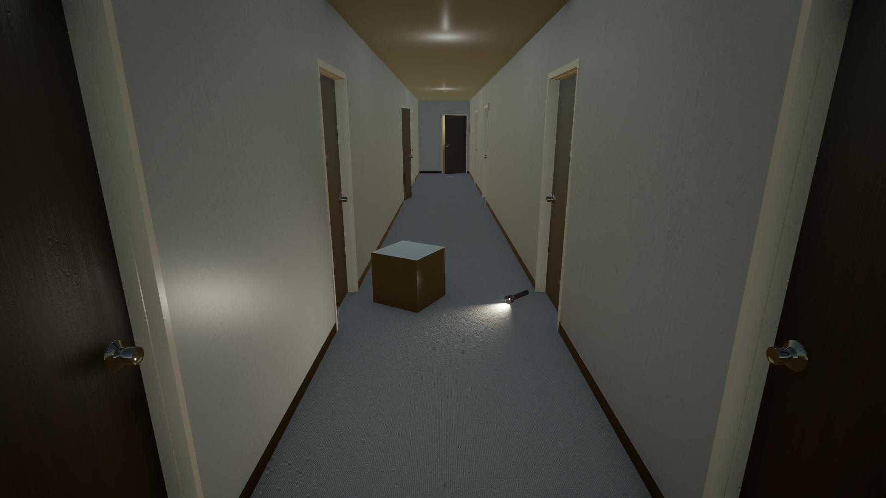 | 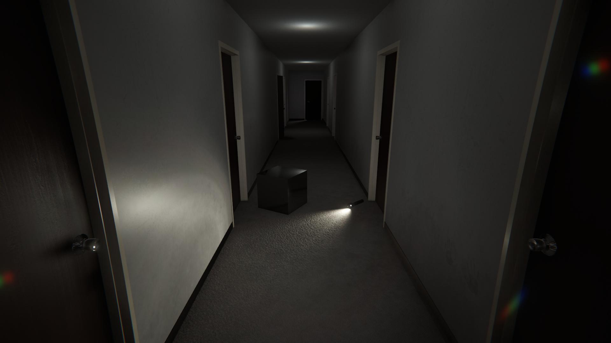 |
| 均一に明るく、CG感が強い | 闇の表現、懐中電灯のムラ、壁の手形、映画のような質感 |

### 用意されているサンプルシーン
- **ダウンロードはこちらから**
[Sample Project](HorrorGraphics.zip)

- **場所**: 古びたホテルの長い一本廊下
- **配置済みオブジェクト**:
  - 廊下の壁・床・天井・ドア
  - 床に落ちている懐中電灯（`Spot Light`）
  - 天井の非常用ライト（`Point Light`）
  - 動作確認用の小道具（`Cube`：動的オブジェクト）

それでは、第1章から順番に見た目を良くしていきましょう！

---

## 全体のロードマップ

- **第1章：Skyboxを変更する**【闇のベース作り】
- **第2章：Cookieを使う**【懐中電灯の光をリアルに】
- **第3章：Decalを使う**【壁や床に恐怖の痕跡を刻む】
- **第4章：Lightmapを使う**【光の跳ね返り（間接光）を焼き付ける】
- **第5章：Reflection Probeを使う**【ドアノブや床の反射をリアルに】
- **第6章：Adaptive Probe Volumeを使う**【動くものも闇に馴染ませる】
- **第7章：PostProcessを使う**【映画のような空気感を完成させる】

---

## 第1章：Skyboxを変更する
### 〜 デフォルトの空から真っ暗な空にして、暗闇を作ろう 〜

| Before：全体的に明るい空間 | After：深い闇の中の空間 |
| :---: | :---: |
|  | 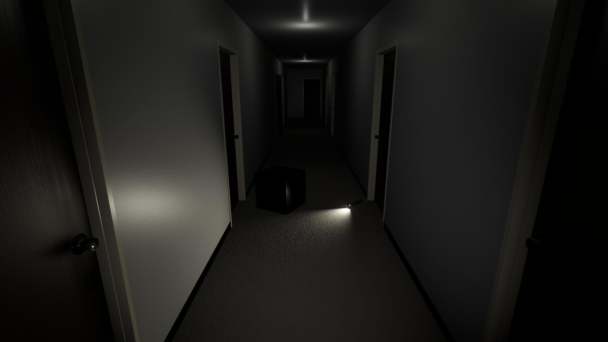 |
| デフォルトの空が反射し、全体的に明るい | ライトの当たっていないところは真っ暗になった |

### 1. この章のゴール
- 昼間のような明るい空を完全な暗闇に変える。
- 部屋の隅や奥がしっかり黒く沈み、ホラーゲームらしくする。

### 2. 実践ステップ

#### ステップ1：真っ黒な空のマテリアルを作成する
1. `Project` ウィンドウの `Assets\Materials` フォルダを右クリックします。
2. **`Create` > `Material`** を選択し、名前を `BlackSkybox` にします。
3. 作成した `BlackSkybox` を選択し、`Inspector` ウィンドウの一番上にある **`Shader`** のドロップダウンを開きます。
4. **`Skybox` > `Cubemap`** を選択します。
5. **`Tint Color`** を **完全な黒（RGB: 0, 0, 0）** に設定します。

<!-- [画像：マテリアルのInspector設定画面] -->

#### ステップ2：シーンのSkyboxに適用する
1. Unity上部メニューから **`Window` > `Rendering` > `Lighting`** を選択して `Lighting` パネルを開きます。
2. 上部の **`Environment`** タブをクリックします。
3. **`Skybox Material`** のスロットに、先ほど作った `BlackSkybox` をドラッグ＆ドロップします。
4. `Lighting` パネル下部にある **`Generate Lighting`** ボタンをクリックします。
5. シーンビューを見て、外の空が消えて真っ黒になったことを確認してください。

<!-- [画像：LightingパネルのEnvironmentタブ設定画面] -->

### 3. どうしてこうなるの？（仕組みの解説）
* **スカイボックスは「巨大な照明」である**:
  Unityでは、空に設定されたテクスチャ全体が淡い光を放ち、シーン全体を均一に照らす「環境光（Ambient Light）」の役割を持っています。
* デフォルトの空のマテリアルが設定されていると、どれだけ部屋のライトを消しても、**空からの光が壁を透過するように入り込んでしまい、完全な闇が作れません**。
* 空を真っ黒にすることで、環境光からの不要な光が遮断され、プレイヤーが設置したライトだけが空間を照らすようになります。

### 4. 初心者がハマる罠・Tips
> [!WARNING]
> **空を黒くしたのに、まだうっすら明るい場合**
> `Lighting` パネル > `Environment` タブにある **`Environment Lighting`** の項目を確認してください。
> - `Source` が `Skybox` になっている場合、Unityが古いスカイボックスの光をキャッシュしていることがあります。
> - または `Source` を **`Color`** に変更し、`Ambient Color`を直接真っ黒 (#000000) に指定すると、完全に外部からの光をカットできます。

---

## 第2章：Cookieを使う
### 〜 懐中電灯の光をリアルにしよう 〜

| Before：均一な光の当たり方 | After：不規則な光の当たり方 |
| :---: | :---: |
|  | 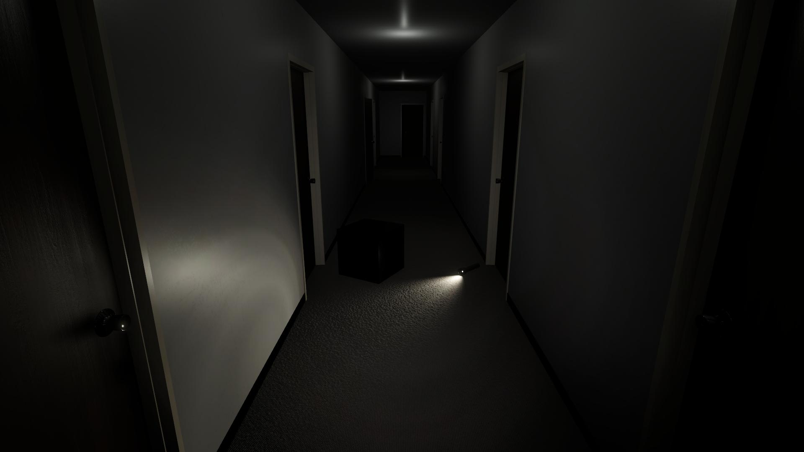 |
| スポットライトの当たる範囲が均一 | スポットライトのレンズの歪みや、反射板のムラがわかる |

### 1. この章のゴール
- 均一なスポットライトの光を、レンズの歪みやホコリ・反射板のムラがある「生々しい懐中電灯の光」に変える。

### 2. 実践ステップ

#### ステップ1：スポットライトにCookieを割り当てる
1. `Hierarchy` ウィンドウから、検索窓に`Spot Light`と入力し、出てきたオブジェクト全てを選択します。
2. `Inspector` の `Light` コンポーネントを開きます。
3. **`Emission`** セクションにある **`Cookie`** のスロットへ、`Project` ウィンドウの `Assets\Textures\SpotLight_Cookie` をドラッグ＆ドロップします。
4. **`Shape`** セクションの **`Inner Spot Angle (左の数字)`** を **`0`** に変更します。
5. シーンビューまたはゲームビューで、床や壁に当たる光の輪郭が懐中電灯の不規則なパターンに変わったことを確認します。

<!-- [画像：Spot LightコンポーネントのCookieスロット設定] -->

### 3. どうしてこうなるの？（仕組みの解説）
* **Cookieは光のステンシル (型紙)**:
  現実の懐中電灯は、電球のフィラメント、リフレクターの凹凸、前面ガラスの細かいキズやホコリによって、光に不規則なムラやリング状の模様ができます。
* 通常CGのスポットライトは均一な光を放つため、安っぽく見えてしまいます。Cookie機能を使うと、**テクスチャ1枚を光源の前にかざすだけで、複雑な手段を用いずにリアルな光の陰影を再現**できます。

### 4. 初心者がハマる罠・Tips
> [!CAUTION]
> **Cookieの色が反映されない**
> Cookieとして使用するテクスチャのインポート設定で **`Texture Type`** を **`Cookie`** にすると、色が反映されなくなってしまいます。これは、Cookieモードではモノクロに対応していないためです。
> また、Universal Render Pipeline Assetsの設定でCookie Atlas FormatがGrayscale系に設定されていると、色が反映されなくなってしまいます。

---

## 第3章：Decal（デカール）を使う
### 〜 壁や床に恐怖の痕跡を刻もう 〜

| Before：小綺麗な部屋 | After：汚れた部屋 |
| :---: | :---: |
|  | 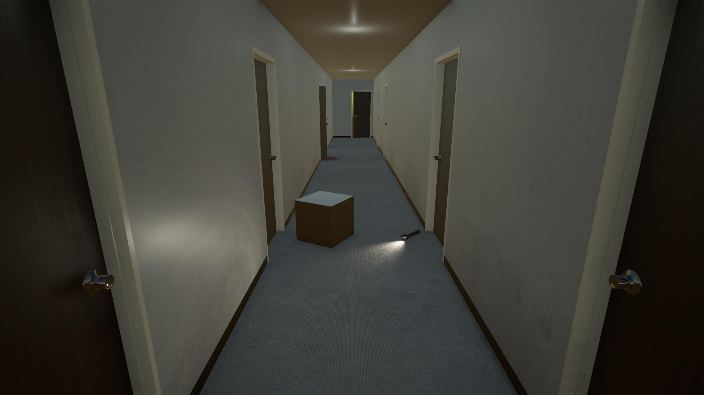 |
| ディテールが少なく、小綺麗な部屋 | 手形・血痕・汚れが追加され、不気味になった部屋 |

### 1. この章のゴール
- 壁のテクスチャや3Dモデルそのものを加工することなく、不気味な手形・血痕・汚れを壁や床へスタンプのように投影する。

### 2. 実践ステップ

#### ステップ1：Universal Renderer DataでDecalを有効にする（事前準備）
1. `Project` ウィンドウの **`Assets\Settings\PC_Renderer`** を選択します。
2. `Inspector` の下部にある **`Add Renderer Feature`** ボタンをクリックします。
3. リストから **`Decal`** を選択して追加します。

<!-- [画像：Renderer FeatureにDecalを追加する画面] -->

#### ステップ2：Decal Projectorをシーンに配置する
1. `Hierarchy` ウィンドウで右クリックし、**`Rendering` > `URP Decal Projector`** を選択します。
2. 名前を `Decal_HandPrint` に変更します。
3. `Decal_HandPrint` の `Inspector` を開きます。
4. **`Material`** スロットに、用意されている手形マテリアル **`Assets\Materials\Decal\HorrorHandprintDecal`** を割り当てます。
5. **`Width`** と **`Height`** を **(0.2, 0.2)** に変更します。
6. **`Tiling`** を **(0.5, 0.5)** に変更します。 ( `Offset` を0.5刻みで調整することで、手形のバリエーションを増やせます。)
7. シーンビューの移動・回転ツールを使い、プロジェクターの白い箱（プロジェクションボックス）が**壁の表面と交差するように配置**します。
8. 壁に手形が浮かび上がれば成功です！他にも `BloodDecal` や `BlackDustDecal` が `Assets\Materials\Decal` フォルダにあるので、使ってみましょう。

> [!CAUTION]
> **Decalを配置しても見えない場合、暗くて見えない可能性があります。その場合は、一時的にシーンを明るくするなどして調整してください。**

<!-- [画像：シーンビューでのDecal Projectorの直方体ギズモと投影結果] -->

### 3. どうしてこうなるの？（仕組みの解説）
* **Decalはプロジェクターで絵を投影する技術**:
  ホラーゲームで「ここに手形をつけたい」「床に血溜まりを置きたい」と思った時、壁や床の3DモデルをBlenderなどで修正するのは大変です。
* `Decal Projector` は、**空間に置いた直方体の枠内にあるオブジェクトの表面に対して、自動的に画像を貼り付けてくれます**。壁と床の境界（角）にまたがっていても、自動で折り曲げて綺麗に投影してくれるのが大きな強みです。

### 4. 初心者がハマる罠・Tips
> [!TIP]
> **手形が表示されない・切れてしまう時**
> 1. プロジェクターの向き（青いZ軸の矢印）が壁の方向を向いているか？
> 2. プロジェクションボックスの `Projection Depth`（奥行き）が薄すぎて、壁の表面に届いていない可能性がないか？少し厚みを持たせて壁を貫通させるように配置するのがコツです。逆に深すぎて意図しない場所まで投影することもあります。

---

## 第4章：Lightmapを使う
### 〜 光の跳ね返り (間接光) を焼き付けよう 〜

| Before：直接光のみ | After：間接光あり |
| :---: | :---: |
| 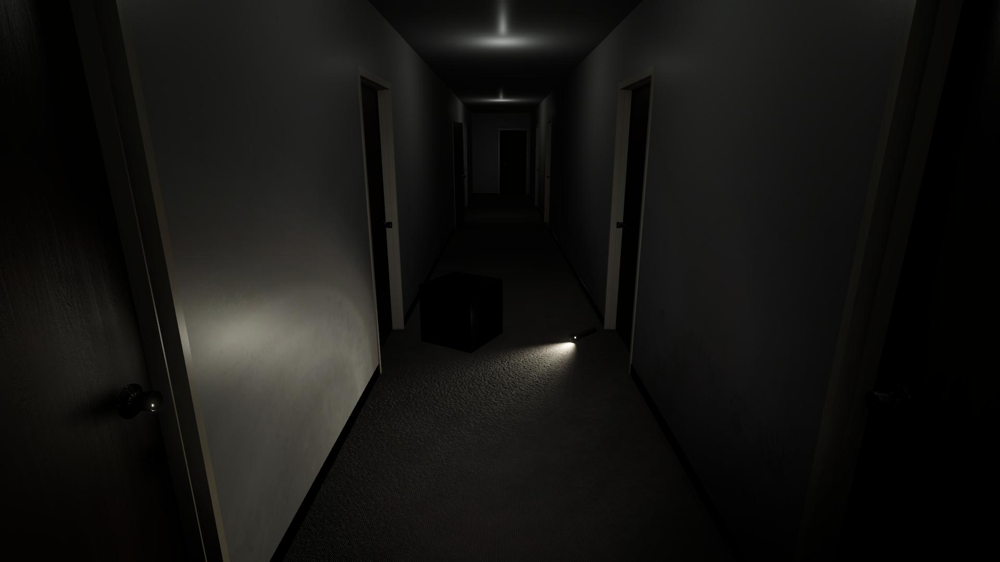 | 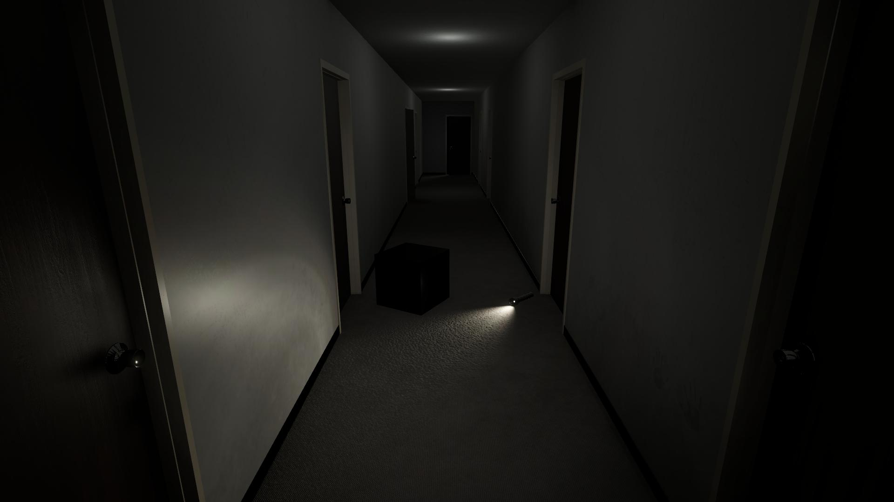 |
| 天井と懐中電灯の光が当たる場所以外は暗い | 光の跳ね返りが追加され、部屋全体がリアルに明るくなった |

### 1. この章のゴール
- 天井のダウンライトと床の懐中電灯の光が、床や壁に当たって周囲へふわっと跳ね返る「間接光（GI）」を計算し、テクスチャに焼き付ける（ベイクする）。
- 光が直接当たっていない場所も、わずかな照り返しで「微かに見える」リアルな暗がりを作る。

### 2. 実践ステップ

#### ステップ1：動かないオブジェクトを「Static」にする
1. `Hierarchy` で、廊下の壁、床、天井、ドアなど、**ゲーム中に絶対に動かない背景オブジェクト**を選択します。(今回は Sceneにある `Level` > `TestHallway` を選択すればOK)
2. `Inspector` の右上にある **`Static`** のチェックボックスをクリックしてONにします。
   （「子オブジェクトも変更しますか？」と出たら **`Yes, change children`** を選択）

<!-- [画像：Inspector右上のStaticチェックボックス] -->

#### ステップ2：ライトのModeを設定する
1. `Hierarchy` から天井のライト（`Level` > `StaticLight` > そこにある `Point Light`全て）を選択します。
2. `Inspector` の `Light` コンポーネントで **`Mode` を `Baked`** に変更します。
3. 床の懐中電灯の中のライト（`Flashlight` > `Spot Light`）を選択し、**`Mode` を `Mixed`** に変更します。

<!-- [画像：LightコンポーネントのModeドロップダウン] -->

#### ステップ3：高速ベイクの設定を行い、ライティングを生成する
1. Unity上部メニューから **`Window` > `Rendering` > `Lighting`** を選択して `Lighting` パネルを開きます。
2. 上部の **`Scene`** タブをクリックします。
3. 以下を設定します：
   - **`Lighting Settings Asset`** : 右の **`New`** ボタンを押す。
   - **`Lightmapper`**: **`Progressive GPU`** に変更（圧倒的に速くなります）
   - **`Importance Sampling`**: チェックを入れる (速度が少し早くなりますが、ノイズが増える可能性あり)
   - **`Lightmap Resolution`**: まずはテスト用に **`16`** 程度に設定（デフォルトの40は時間がかかる可能性あり）
4. 右下の **`Generate Lighting`** ボタンを押す。
5. 画面右下にプログレスバーが表示され、ベイクが完了するとシーン全体に柔らかい陰影と光の跳ね返りが定着します。

<!-- [画像：LightingパネルでのGPU Lightmapper設定とGenerate Lightingボタン] -->

### 3. どうしてこうなるの？（仕組みの解説）
* **間接光（グローバルイルミネーション / GI）**:
  現実世界では、光は壁や床にぶつかると跳ね返り、部屋全体をほんのり照らします。
  CGでこの計算をリアルタイムで毎フレーム行うには処理が重すぎます。
* そこで、**動かないものに対する光の計算結果を、あらかじめ画像（ライトマップ）として壁や床に焼き付けておく**のがライトマップです。
* **なぜ天井はBakedで懐中電灯はMixedなのか？**:
  - **`Baked`**: 完全に焼き付けるため実行時の負荷はゼロ。固定された環境照明に最適。
  - **`Mixed`**: 動かない背景には間接光を焼き付けつつ、プレイヤーや動く敵にはリアルタイムで光と影を落とすことができる、便利なハイブリッド設定です。

### 4. 初心者がハマる罠・Tips
> [!IMPORTANT]
> **ベイクが何十分も終わらない時のチェック！**
> - `Lightmapper` が `Progressive CPU` になっていませんか？ `Progressive GPU` に変更しましょう。
> - `Lightmap Resolution` が高すぎませんか？ 最初は `8〜10` で全体の雰囲気を確認し、最終調整時だけ `20〜30` に上げてみましょう。
> - 動くはずの小道具（テスト用Cubeやプレイヤー）のStaticに誤ってチェックが入っていませんか？

---

## 第5章：Reflection Probeを使う
### 〜 ドアノブや床の反射をリアルにしよう 〜

| Before：反射が真っ暗 | After：部屋が反射する |
| :---: | :---: |
|  | 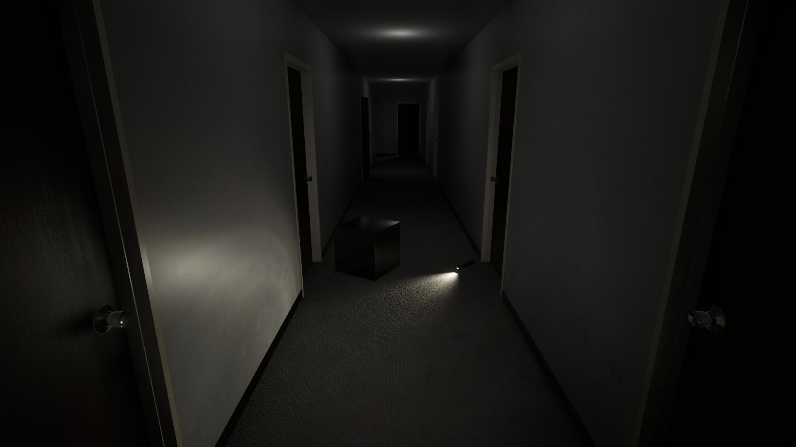 |
| 反射すべき箇所がスカイボックスの反映で真っ黒 | キューブやドアノブに廊下が映り込んでいる |

### 1. この章のゴール
- 金属製のドアノブやツヤのある床に、「外の青空」ではなく「薄暗いホテルの廊下の光景」を正しく映り込ませる。

### 2. 実践ステップ

#### ステップ1：Reflection Probeを配置する
1. `Hierarchy` で右クリックし、**`Light` > `Reflection Probe`** を作成します。
2. 廊下の中心付近（X: 1.18, Y: 1.75, Z: 6.18）に移動します。

<!-- [画像：シーンビューに配置されたReflection Probe球体] -->

#### ステップ2：Box Projectionを有効にし、部屋のサイズに合わせる
1. `Reflection Probe` の `Inspector` を開きます。
2. **`Box Projection`** のチェックボックスを **ON** にします。
3. **`Blend Distance`** を **`0`** に設定します。
4. **`Box Size`** を調整し、黄色の直方体ギズモが**廊下の壁・天井・床の内側よりほんのちょっとだけ大きく**なるように広げます。
   （例：X: 2.2, Y: 2.6, Z: 16.3 など廊下の寸法に合わせる）
5. インスペクター下部の **`Bake`** ボタンをクリックします。
6. 金属のドアノブやキューブを見て、廊下の壁や天井のライトが正しく反射して映り込んでいるか確認します。

<!-- [画像：Box Projectionのサイズ調整ギズモとインスペクター設定] -->

### 3. どうしてこうなるの？（仕組みの解説）
* **Reflection Probeは360度カメラ**:
  プローブを置いた位置から全方位の写真を撮影し、周囲の物体に鏡の反射として貼り付ける仕組みです。
* **なぜBox Projectionが必要なのか？**:
  通常のReflection Probeは無限に遠い屋外の景色を想定して反射を計算します。そのため、狭い廊下に置くと反射像が大きく歪んでしまいます。
  `Box Projection` をONにすると、**直方体の部屋の壁を考慮して反射を補正してくれるため、室内の反射が劇的に自然になります**。

### 4. 初心者がハマる罠・Tips
> [!WARNING]
> **反射が真っ黒になってしまう場合**
> 周囲の壁や天井のオブジェクトがStaticになっているか確認してください。Reflection Probeが撮影する際、静的オブジェクトでないと背景として映り込まない場合があります。

---

## 第6章：Adaptive Probe Volumes (APV) を使う
### 〜 動くものも闇に馴染ませよう 〜

| Before：ものの明るさが変わらない | After：場所に応じて明るさが変わる |
| :---: | :---: |
| 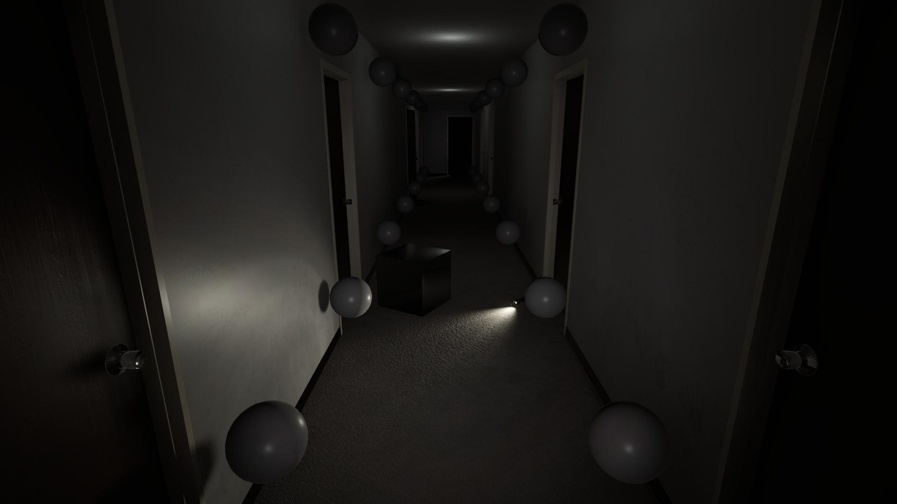 | 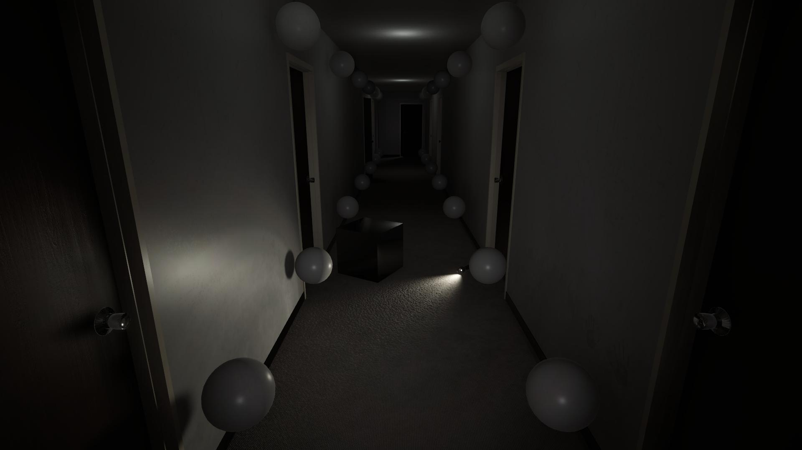 |
| 直接光が当たる場所以外は暗い、反射によりそれっぽくは見えるが... | 天井の光源等場所によって明るさが変化して馴染んでいる |

### 1. この章のゴール
- 動くオブジェクト（テスト用のCubeや、徘徊するクリーチャーなど）が、静的な廊下の光と影をリアルタイムかつ自然に受け取るようにする。

### 2. 実践ステップ

#### ステップ1：Project SettingsでAPVを有効化する
1. `Project` ウィンドウの **`Assets\Settings\PC_RPAsset`** を選択します。
2. `Inspector` ウインドウで **`Lighting`** セクションにある **`Light Probe System`** を、**`Adaptive Probe Volumes`** に切り替えます。

<!-- [画像：Project SettingsでAPVを有効化する設定画面] -->

#### ステップ2：Adaptive Probe Volumeをシーンに配置する
1. `Hierarchy` で右クリックし、**`Light` > `Adaptive Probe Volume`** を作成します。
2. `Inspector` で **`Mode` を `Global`**（または廊下を囲む `Scene`）に設定します。
3. `Lighting` パネル（`Window` > `Rendering` > `Lighting`）を開き、再度 **`Generate Lighting`** をクリックします。

<!-- [画像：シーンビューに自動配置されたAPVのプローブグリッド] -->

#### ステップ3：Cubeを動かして効果を体感する
1. シーン内に `Cube` を配置し、移動ツールで懐中電灯の光の近くから、奥の暗闇へと動かしてみます。
2. キューブの表面が、周囲の明るさに応じて滑らかに暗闇に溶け込んだり、光を受けたりするのを確認してください。

### 3. どうしてこうなるの？（仕組みの解説）
* **ライトマップの弱点を補う動的ライティング**:
  ライトマップは壁や床のような動かないものにしか使えません。そのため、キャラクターや小道具が暗闇に入ったとき用に、従来は手作業で点々とLight Probeを並べる必要がありました。
* **Unity 6のAPVのすごさ**:
  1. **完全自動配置**: 壁の近くは細かく、何もない広い空間は粗くと、自動で最適な密度でプローブを配置してくれます。
  2. **ピクセル単位のサンプリング**: 大きなクリーチャーの足元だけが光に照らされ、頭は闇に沈んでいるといった、極めて不気味でリアルなホラー表現が可能になります。

### 4. 初心者がハマる罠・Tips
> [!NOTE]
> **壁の向こうの光が漏れてくるときの対策**
> 薄い壁の近くでは、隣の部屋の明るい光をプローブが拾ってしまうことがあります。
> Unity 6では **`Probe Adjustment Volume`** というコンポーネントを追加することで、問題のある箇所のプローブを手動で無効化して光漏れを防ぐことができます。

---

## 第7章：PostProcessを使う
### 〜 映画のような空気感を完成させよう 〜

| Before： これも悪くない | After：見やすくなり、演出も増えた |
| :---: | :---: |
| 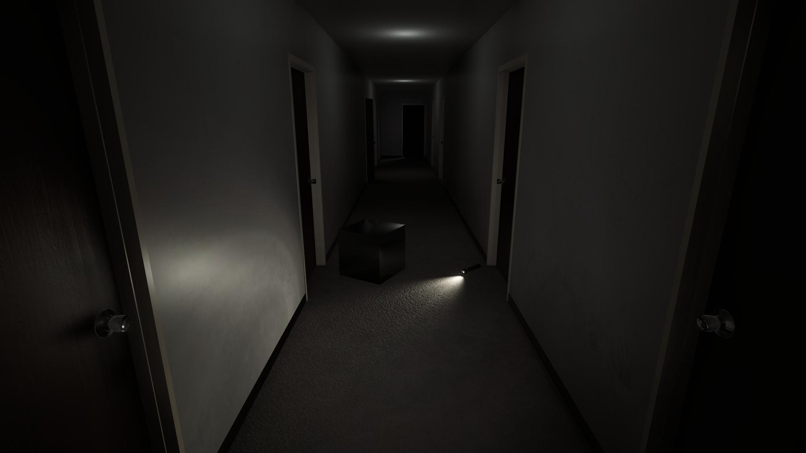 | 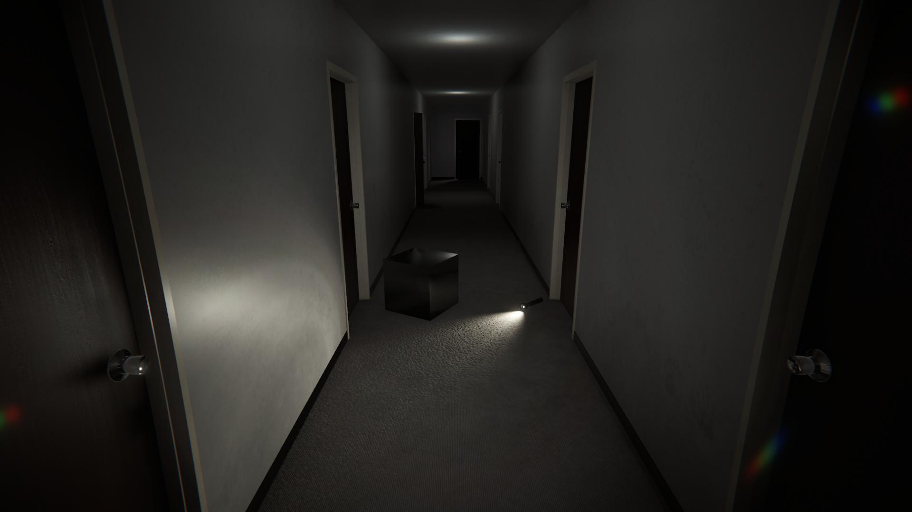 |
| Unityのデフォルト設定も悪くない | ゲームや場に合わせた雰囲気にできる |

### 1. この章のゴール
- トーンマッピング、ビネット（四隅の暗がり）、フィルムグレイン（粒子ノイズ）、色収差等を追加し、まるで映画や監視カメラの映像を見ているようなホラー空間を完成させる！

### 2. 実践ステップ

#### ステップ1：Main CameraのPost ProcessingをONにする
1. `Hierarchy` で **`Main Camera`** を選択します。
2. `Inspector` の `Camera` コンポーネント > **`Rendering`** セクションを開きます。
3. **`Post Processing`** のチェックボックスが **ON** になっていることを確認します。

<!-- [画像：Main CameraのPost Processingチェック] -->

#### ステップ2：Global Volumeを作成し、エフェクトを追加する
1. `Hierarchy` で右クリックし、**`Volume` > `Global Volume`** を作成します。
2. `Inspector` の `Volume` コンポーネントにある `Profile` の横の **`New`** ボタンをクリックしてプロファイルを作成します。
3. **`Add Override`** ボタンを押し、以下のエフェクトを順番に追加・調整していきます：

##### ① Tonemapping
- CG特有の白飛びを抑えます。
- `Mode`: **`Neutral`**

##### ② Color Adjustments
- 画面を明るくし、彩度も下げることで不気味な雰囲気を出します。
- `Post Exposure`: `1`（全体を明るくする）
- `Saturation`: `-10`（彩度を下げる）

##### ③ Vignette（ビネット）
- 画面の四隅を暗く落とし、圧迫感を出します。
- `Intensity`: `0.4`

##### ④ Film Grain（フィルムグレイン）
- 暗闇にザラザラとしたノイズを走らせ、アナログ感や光量不足によるザラつきを表現します。
- `Type`: `Medium 1`
- `Intensity`: `0.15`

##### ⑤ Chromatic Aberration（色収差）
- 画面の端に色ズレを生じさせ、レンズによる色収差や精神異常のような不快感を演出します。
- `Intensity`: `0.06`

##### ⑥ Lens Distortion（レンズ歪曲）
- 画面全体を歪ませ、レンズによる歪曲収差の演出や遠近感の強調をします。
- `Intensity`: `-0.15`

<!-- [画像：Global VolumeのInspector設定一覧] -->

### 3. どうしてこうなるの？（仕組みの解説）
* **物理的なライティング ＋ カメラのレンズ効果 ＝ 世界観の完成**:
  1〜6章で空間の光を正しく組み立ててきました。しかし、ゲーム画面は最終的に**カメラのレンズを通してプレイヤーの目に届きます**。
* ビネットで視野を狭め、フィルムグレインで視界を不安定にすることで、プレイヤーの脳に「この場所は危険だ」という心理的緊張感を与えることができます。
* 自身の好みに合うように、設定を調整してみてください。

| 現在の設定 | 暗さを強調した設定 |　明るくした場合　|
| :---: | :---: | :---: |
|  | 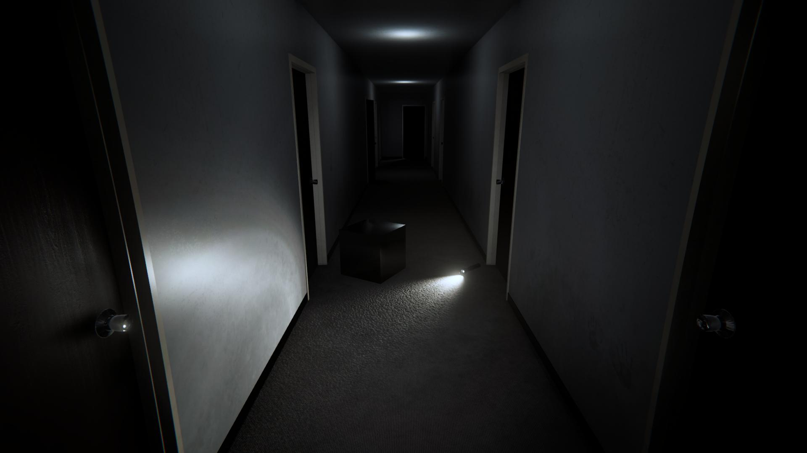 | 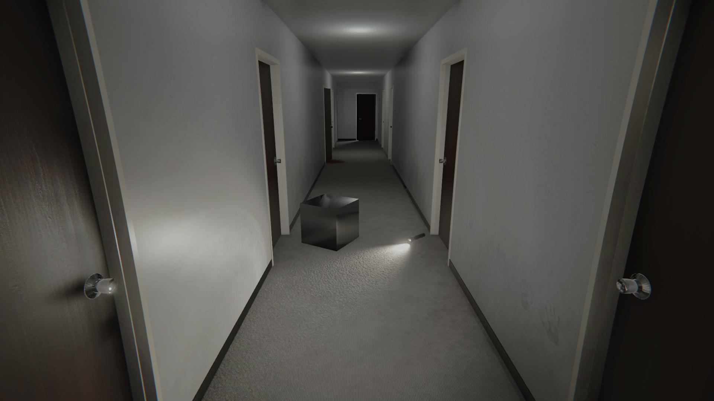 |
| バランス重視 | 暗さによる恐怖を強調 |  Liminal space向きの表現 |

### 4. 初心者がハマる罠・Tips
> [!TIP]
> **Screen Space Ambient Occlusion（SSAO）**
> SSAOは、物体と物体の接地点を暗くすることで、立体感や接地感を強調するエフェクトです。ホラーゲームでは必須級の便利機能ですが、設定を間違えると画面全体が暗くなってしまいます。
> 第3章のDecalで触れた **Universal Renderer Data** に、SSAOの設定項目があるので、ぜひチェックしてみてください。

---

## まとめと次のステップ

全7章お疲れ様でした！
最初ののっぺりとした明るい廊下と見比べてみてください。光と影のコントラスト・不気味な汚れ・不安感を与えるエフェクトが一体となった、それっぽいホラー空間が完成したはずです。

### さらにクオリティを高めるための挑戦
1. **埃のパーティクルを追加**:
   - 荒廃した空間の表現として、埃のパーティクルを追加することで、よりリアルな表現ができます。また、光の筋に埃が重なることで、幻想的な雰囲気も演出できます。
2. **環境音（3Dオーディオ）の統合**:
   - 遠くで滴る水滴の音、建物の軋み音、蛍光灯のジーというノイズなどを配置すると、視覚効果と相乗して恐怖が何倍にも跳ね上がります。

この資料をベースに、自分だけのオリジナルホラー空間の制作にぜひ挑戦してみてください！

---

#### オマケ

> [!NOTE]
> このプロジェクトで利用した素材は3Dモデル以外自由に使うことができます。

> [!TIP]
> Universal Renderer DataにあるSharpeningFilterをONにすると...?